# Automating IT Asset Agreements with Snipe-IT, n8n and Documenso on AWS

> **Status: in progress (October 2026).** Done and tested: the infrastructure (built by hand in the AWS console), the signing automation on n8n Cloud secured with mTLS, and a rebuild on self-hosted n8n with every system on one business timezone, compared side by side below. **Still to come:** rebuilding the infrastructure with Terraform.

## In short

When IT hands out or takes back a laptop or phone, someone has to fill in an assignment form, get it signed by the employee and by IT, and file the signed copy where an auditor can find it. I automated that whole loop:

1. IT checks an asset out (or in) in **Snipe-IT**.
2. **n8n** confirms the event is real, fills in the right agreement with the asset and employee details, and sends it through **Documenso** for signature: employee first, then the IT admin who did the checkout.
3. When both have signed, n8n attaches the signed PDF to the asset in Snipe-IT and files a backup copy in **Google Drive**, in a folder per asset.
4. If the employee rejects it, never signs, or anything fails, IT gets an email.

Snipe-IT runs on AWS (EC2 + RDS) that I built myself. n8n and Documenso are cloud services. The part I'm proudest of isn't the automation itself, but how a cloud tool with no fixed IP address talks to a private internal system without that system being opened to the internet.

## The problem

Without automation, the agreement step is the one that gets skipped. The checkout is done in Snipe-IT, the form is a Word document someone fills in by hand, it gets signed (or forgotten), and the signed copy ends up in someone's email. When an audit asks "show me who has laptop 00001 and that they agreed to the usage policy", the answer is a search through inboxes.

I wanted the asset record itself to hold the evidence: every checkout and return of a device, with the signed agreement attached and a note of what happened, without IT doing anything beyond the checkout they already do.

### Why it matters

A signed handover record is something companies need at specific moments, usually long after the handover:

| Situation | What the signed record gives you |
|---|---|
| Offboarding | Proof of which devices the employee holds and whether they came back, with IT's notes on their condition |
| Lost or damaged device | A signed acceptance of responsibility, which HR or legal need before any recovery (subject to local labor law) |
| Audits (ISO 27001, SOC 2) | ISO 27001 has controls for asset inventory, acceptable use and return of assets. When an auditor samples a laptop, the signed agreement is on its record |
| Disputes ("I never received that laptop") | An e-signature with a timestamped audit trail, countersigned by the IT admin who handed it over |
| Remote and hybrid staff | Nothing to print or scan; employees sign from an email |

As built, this suits small and mid-size companies that run Snipe-IT, and managed service providers handling IT for several clients. Larger companies usually do the same job with ServiceNow, Intune or Jamf and DocuSign. The tools differ but the pattern is the same: the system of record triggers the agreement, the signed result goes back to the system of record, and every failure reaches a person.

### Why not Snipe-IT's built-in acceptance?

Snipe-IT can require users to accept assets in a category, optionally with a signature, and keeps a record of the acceptance. For some teams that's enough, so it's the first question to answer. (I haven't tested it in this instance yet; I'll confirm these points against it before finalizing this write-up.)

| | Snipe-IT acceptance | This automation |
|---|---|---|
| Employee needs a Snipe-IT login | Yes | No, they sign from an email |
| Return form with condition notes | No, acceptance is for checkout | Yes, a separate return form on check-in |
| IT countersignature | No | Yes, by the admin who did the handover |
| Signing audit trail | Acceptance record in Snipe-IT | Documenso's signing certificate and audit log |
| Copy outside Snipe-IT | No | Google Drive, a folder per asset |
| Reminders and failure alerts | No | Unsigned reminder, rejection and error emails |
| Moving parts | None, it's built in | Three extra services to run and secure |

If a company only needs employees to acknowledge checkouts and everyone already logs into Snipe-IT, the built-in feature is the better choice. This automation earns its extra parts when returns, countersignatures or an off-system archive are required.

## Architecture

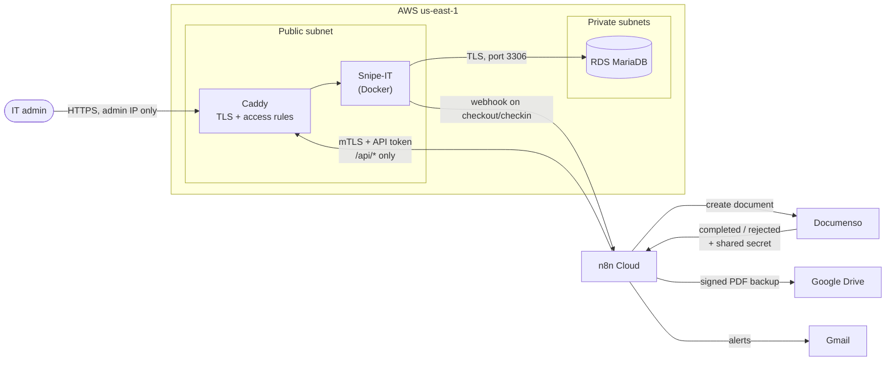

| Layer | What runs there |
|---|---|
| Network | VPC across two availability zones: public subnets for the app, private subnets for the database, no NAT gateway |
| App server | EC2 t3.small, Amazon Linux 2023, Snipe-IT and Caddy in Docker Compose, Elastic IP |
| Database | RDS MariaDB (db.t3.micro), private, reachable only from the app server's security group, TLS required and verified |
| Access to the server | AWS Systems Manager Session Manager. No SSH port is open at all |
| TLS | Caddy obtains and renews Let's Encrypt certificates automatically |
| Automation | n8n Cloud, four workflows |
| E-signature | Documenso Cloud (free plan, API and webhooks) |
| Backup and alerts | Google Drive and Gmail via n8n |

## Key decisions

| Decision | Why |
|---|---|
| Build everything by hand in the console first, Terraform later | I wanted to understand each AWS resource before describing it as code. Several mistakes below only happened because I was clicking, and each one became a concrete reason for IaC. |
| Database in private subnets | No route to the internet means no path in, even with the right credentials. Security groups then add a second layer. |
| Security-group reference instead of an IP range for database access | The rule follows the app server through rebuilds, and nothing else in the subnet can reach the database. |
| SSM Session Manager instead of SSH | Nothing listens for inbound connections, so there's nothing to brute-force, and there are no SSH keys to manage. Access is controlled by IAM. |
| No NAT gateway | About $32/month for something nothing in the private subnets needs. |
| Caddy instead of an ALB + ACM | One server doesn't need a load balancer. Caddy gives automatic HTTPS for free. |
| Least-privilege API user for n8n | The `n8n-bot` account can view assets and users, add notes and upload files. It can't check out, check in, delete, or see licenses. I verified this by testing the token, not by trusting the settings page (which turned out to be wrong the first time). |
| Webhook as a signal, API as the source of truth | Snipe-IT's webhook can't carry a secret, so anyone who learns the n8n URL could send a fake "checked out" event. n8n only acts if Snipe-IT's own activity log, fetched over the authenticated API, confirms it. |
| Rejections only notify | If the employee rejects the agreement, IT gets an email and the asset gets a note. The checkout is never reversed automatically, because the device may already be in the employee's hands. |

## Building the infrastructure by hand

I built the VPC, security groups, RDS, IAM role and EC2 instance in the AWS console, then installed Docker, Snipe-IT and Caddy on the instance myself over Session Manager.

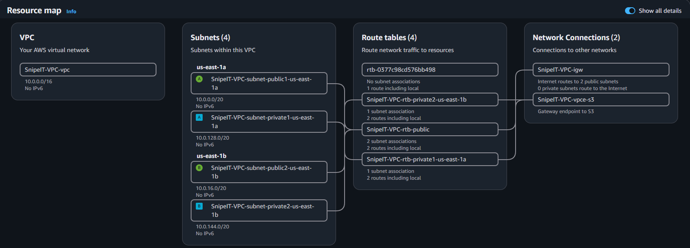

The two security groups tell the access story on their own: the app server accepts web traffic, and the database accepts only the app server.

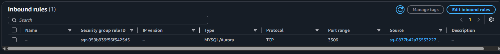

Before installing any application, I tested the network design directly: an SSM session on the app server, then a MySQL connection to RDS over TLS. Seeing the `snipeit` database listed proved the private routing, the security-group rule and the database setup in one step.

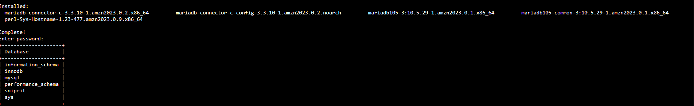

### Mistakes that made the case for Terraform

- **A production-size database by accident.** The console's template picked `db.r7g.large` (about $170/month) instead of a micro instance. RDS storage can't be shrunk, so I deleted and recreated it, and set up a budget alert. In Terraform, `instance_class` is written down and reviewed; there's no template default to accept by accident.
- **A setting hidden in a collapsed panel.** I skipped "Initial database name" because it was inside "Additional configuration". In code it's one line that's applied on every rebuild.
- **The app server in the wrong subnet, twice.** Its private IP (`10.0.133.x`) gave it away: that range belonged to the private subnet, so the Elastic IP could never work. The second time, "Launch more like this" quietly copied the wrong subnet. In Terraform the subnet is referenced by a meaningful name, not picked from a list of similar IDs.

### Things I only learned by watching the logs

- **A new hostname is public the moment it gets a certificate.** Within seconds of Caddy getting the Let's Encrypt certificate, unrelated scanners started requesting the site. Every certificate is published in Certificate Transparency logs, and scanners watch them. Snipe-IT's setup wizard lets whoever reaches it first create the admin account, so I limited the server to my own IP until setup was done.
- **Reading the source beat guessing.** Snipe-IT's setup check said the site was plain HTTP even though it was served over HTTPS. Its source code showed that recent versions trust no proxy headers at all unless each one is listed in `APP_TRUSTED_HEADERS`, a setting missing from its own example config.

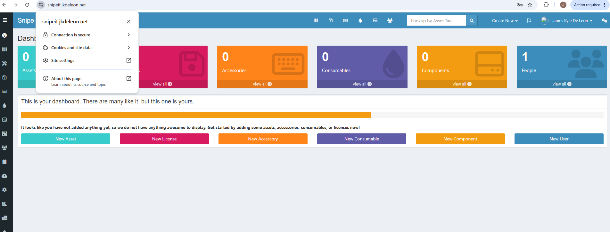

## Connecting a cloud automation tool to a private system

n8n Cloud needs to call Snipe-IT's API, but n8n Cloud has no fixed outgoing IP address: its addresses change without warning and are shared by every n8n Cloud customer. An IP allowlist would be both unreliable and meaningless.

So instead of asking *where* a request comes from, the server checks *who* is making it:

- Snipe-IT's API gets its own hostname, `snipeit-api.jkdeleon.net`, where Caddy requires **mutual TLS**: the client must present a certificate signed by a private certificate authority (CA) I created with OpenSSL. Without one, the connection is refused during the TLS handshake, before any request reaches Snipe-IT. Only `/api/*` is passed through.
- On top of that, every call needs the `n8n-bot` API token.
- The web interface stays on its own hostname, limited to my IP by Caddy.
- The CA's private key never goes on the server; the server only holds the CA's public certificate.

I tested each layer, from my PC and from n8n:

| Test | Result |
|---|---|
| No client certificate | Refused at the handshake (`alert certificate required`) |
| Certificate from a different CA | Refused at the handshake |
| Valid certificate, no token | `401 Unauthorized` |
| Valid certificate, path outside `/api/*` | `404 Not Found` |
| Asking for the API site through the UI hostname | `421 Misdirected Request` (Caddy checks that the HTTP host matches the TLS server name) |
| Valid certificate and token | `200 OK` |

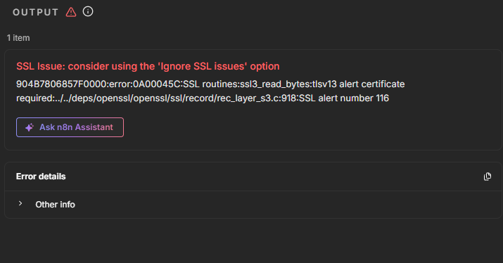

An alternative I rejected: automatically syncing the security group with n8n's published IP list. That list is shared by all n8n Cloud customers, so it would let all of them in. In a company already on Cloudflare, I'd use a tunnel instead, which needs no inbound ports at all.

## The automation

Four n8n workflows, exported in [`n8n/workflows/`](../n8n/workflows/):

| Workflow | Trigger | What it does |
|---|---|---|
| 01 Send for signature | Snipe-IT webhook | Confirms the event against the activity log, skips duplicates, fetches asset and people, creates the Documenso document from the right template |
| 02 Archive on completion | Documenso webhook (shared secret required) | Completed: downloads the signed PDF, attaches it to the asset, files it in Drive. Rejected: emails the other signers and notes the asset |
| 03 Unsigned reminder | Daily at 9:00 | Emails IT a list of agreements still unsigned after 3 days |
| 04 Error handler | Any workflow failure | Emails IT the workflow, the failed step and a link to the run |

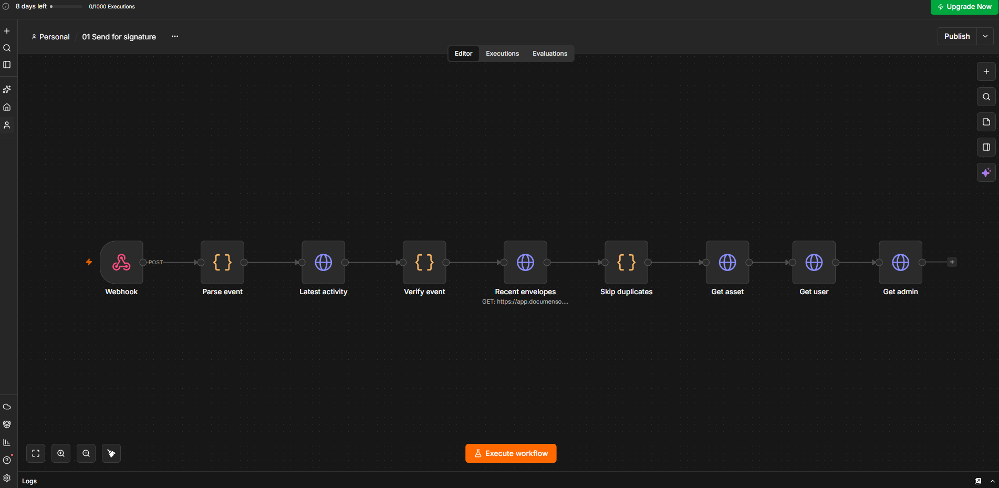

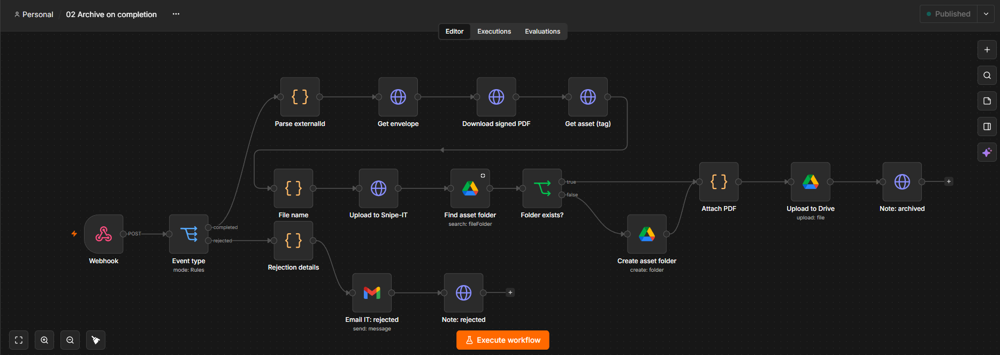

A few details that matter:

- **How a signed document finds its way back to the right asset.** The document is created with an `externalId` like `checkout:asset-1:log-13`. Days later, Documenso's "completed" event carries it back, and that string is the only link between the signed PDF and the asset. No database is needed; Documenso holds the state.
- **Duplicate protection.** Before creating a document, Workflow 1 checks whether one with the same `externalId` already exists. A retried webhook can't create a second document (which matters on a free plan with 5 documents a month).
- **The pre-filled agreement.** The employee sees the asset tag, model, serial number and date already filled in and read-only, because they're confirming exactly what they received.

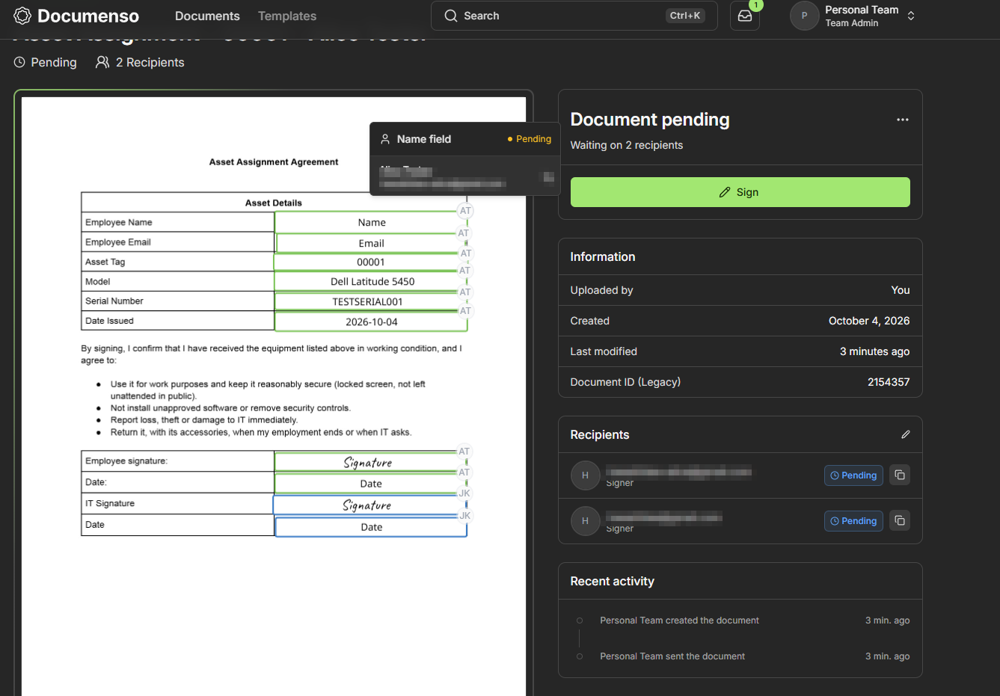

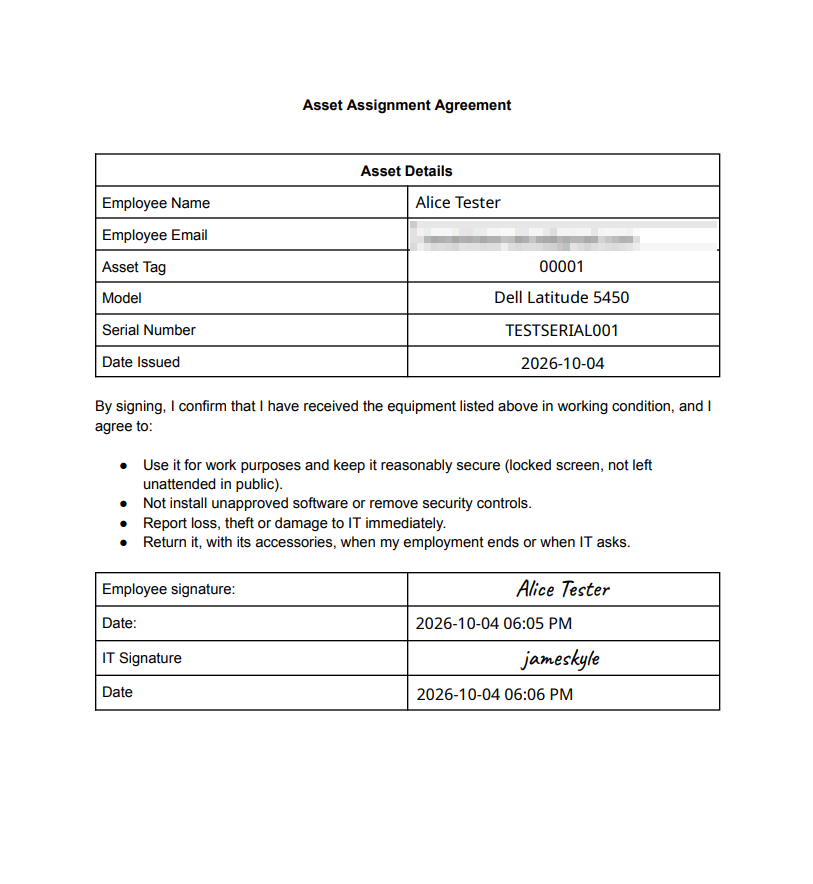

- **The archive.** The signed PDF is attached to the asset, uploaded by the bot account, so the audit trail shows the automation did it.

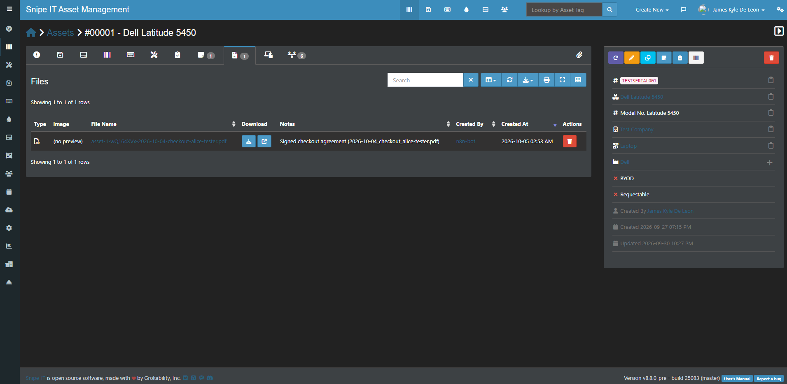

- **The backup.** Each asset gets its own folder in Google Drive, created on first use, so one device's whole history (assignment and return) is in one place.

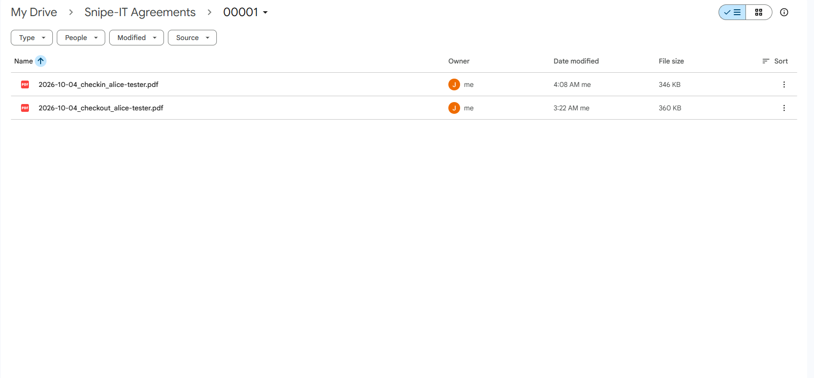

## Testing with three real documents

The free Documenso plan allows 5 documents a month, so I planned the tests around 3. Everything before the "create document" step was built and re-run on pinned data, which n8n replays without calling Snipe-IT again.

| Document | Path tested | Result |
|---|---|---|
| #1 | Checkout, signed, archived | Pass. Also used to test the reminder while it was still unsigned |
| #2 | Check-in, signed in order, archived, fully automatic in production | Pass |
| #3 | Checkout, rejected by the employee | Pass. IT emailed, note added, checkout left unchanged |

Plus tests that used no documents at all: a forged Snipe-IT webhook stopped at verification, a forged Documenso event without the secret was refused with `403`, the old webhook secret was refused after rotating it, and a deliberate production failure triggered the error email.

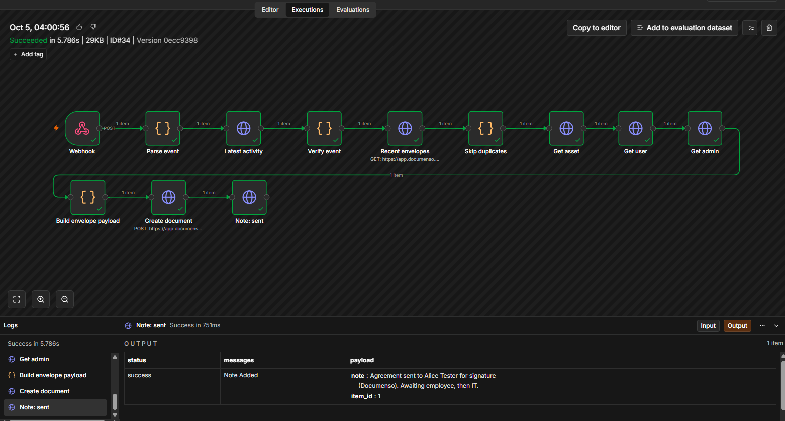

When the employee rejected document #3, IT got an email naming who rejected it, with a link to the asset (this was before I switched the emails to HTML, hence the single line):

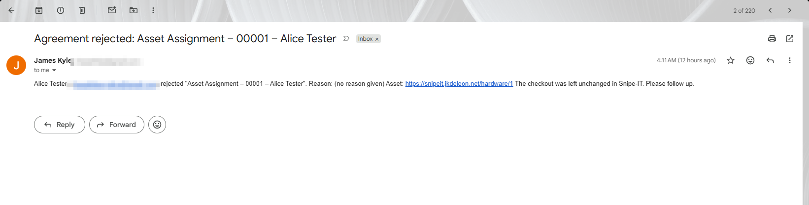

To test the error handler, I made the harmless reminder workflow fail on purpose in production (error workflows don't fire for manual test runs):

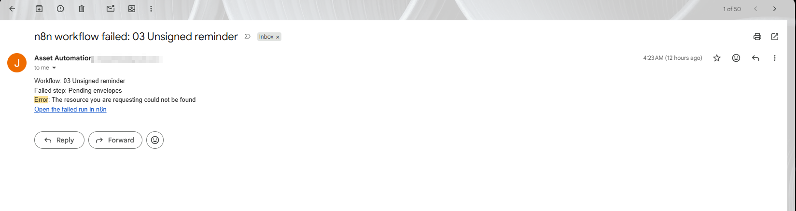

## Bugs I found by testing

- **Verification that was too strict.** Workflow 1 checked the asset's latest activity. After it added its own "agreement sent" note, the latest activity was that note, so a genuine retry looked forged. It failed safely, but in real use, any note or edit right after a checkout would have silently stopped the agreement from ever being sent. Fix: ask Snipe-IT for the latest activity *of that type*.
- **Signing order that wasn't enforced.** Numbering the signers 1 and 2 in the API only labels them. Documenso enforces the order only when the template has "Enable signing order" on. With it off, IT could countersign before the employee, without even seeing which asset it was for.
- **A field assigned to the wrong person.** The return form's "condition notes" field was assigned to the employee and read-only, so IT couldn't fill it in. It showed up in the first real return form.
- **The webhook secret in the logs.** Documenso sends its secret as a request header, so n8n records it in every execution's data. After it ended up pasted in a chat, I rotated it and confirmed the old value was refused.
- **A Google Drive folder n8n couldn't see.** I had created the root folder in a different Google account from the one connected to n8n.

## Rebuilding with self-hosted n8n, and comparing the two

Once the n8n Cloud version worked, I rebuilt the same four workflows on **n8n self-hosted**, as a third container next to Snipe-IT on the same server, and compared the two deployments. The workflows themselves barely changed: a script swapped the nine Snipe-IT URLs from the mTLS hostname to the internal Docker address (`http://app/api/v1`) and removed the client-certificate settings.

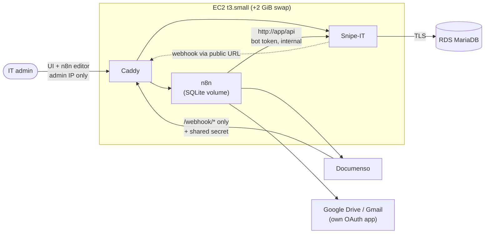

Decisions for the rebuild: keep the t3.small and add 2 GiB of swap (measured before deciding), SQLite for n8n's data, one hostname (`n8n.jkdeleon.net`) where only `/webhook/*` is public and the editor is limited to my IP, a pinned n8n version, and **Asia/Qatar as the one business timezone** across Snipe-IT, n8n, the agreement dates and Documenso's signing times.

| | n8n Cloud + mTLS | Self-hosted n8n |
|---|---|---|
| **Setup effort** | Private CA, client certificate, a second hostname with mTLS in Caddy, DNS record, and n8n's built-in Google sign-in. Not tracked in minutes; it was the bulk of a multi-day build | About 4 hours of hands-on work across five sessions, timed from the session logs. That includes two detours: Google's app-publishing requirements and one wrong import |
| **Public attack surface** | Snipe-IT UI (admin IP only) and the API hostname (mTLS + token) | Snipe-IT UI and the n8n editor (both admin IP only), and **only `/webhook/*`** on n8n: WF1 verifies every event against Snipe-IT's log, and WF2 requires a shared secret. The API hostname is gone |
| **Who can reach Snipe-IT's API** | Anyone holding the client certificate **and** the bot token, from anywhere | Only the n8n container, over the Docker network. The audit trail shows it: n8n Cloud's calls were logged from `4.184.78.244` (a public IP shared by n8n Cloud customers), the self-hosted ones from `172.18.0.3` |
| **Blast radius if n8n is compromised** | The bot token's permissions only | The bot token, plus a foothold on the server that also runs Snipe-IT. Self-hosting trades an external dependency for a shared host |
| **Operations** | Yearly client-certificate renewal and custody of the CA key. n8n upgrades and backups are n8n's job | n8n upgrades (version pinned; n8n already warns that its built-in task-runner mode is deprecated), backups (EBS snapshot + the offline encryption key), and my own Google OAuth app, which needed a home page and a privacy policy before Google would let it out of "Testing" (otherwise logins expire every 7 days) |
| **Cost** | n8n Cloud Starter: €20/month billed annually (2,500 runs/month), checked on n8n's pricing page in October 2026 | **$0 extra compute.** Measured: 831 MiB of 1.9 GiB used after a real document, n8n at 419 MiB, swap never touched (screenshots 33 and 34) |
| **Fit with Terraform** | Server config fits, but the CA and the n8n Cloud setup live outside Terraform | Everything except the Google OAuth app lives on one host: compose file, Caddyfile, `n8n.env` and the swap file all go into user-data |

What the rebuild proved, with one real document (#4) and replayed events instead of new ones:

- **The timezone fix holds everywhere.** The agreement date comes from Snipe-IT's own log entry instead of "now in UTC", the archive file name from Documenso's completion time, and Documenso stamps signing times in Qatar time. A pinned log entry at 00:15 Qatar time (21:15 UTC the day before) produced the right date. Records created before the switch still show the old timezone's clock time, which is exactly why the timezone has to be set before go-live.
- **Duplicates, forgeries and bad secrets are all stopped.** The real checkout message re-sent stopped at the duplicate check; a forged checkout stopped at verification; a wrong or missing Documenso secret got `403` before the workflow started.
- **The error handler caught a real failure.** A replay with malformed test data failed in production, and WF4 emailed IT the workflow and the failing step, unprompted.
- **Every secret n8n Cloud held was replaced or revoked**: the webhook secret, the bot token (created from Laravel's console on the server, without logging in as the bot), the Documenso token, and n8n Cloud's Google access.

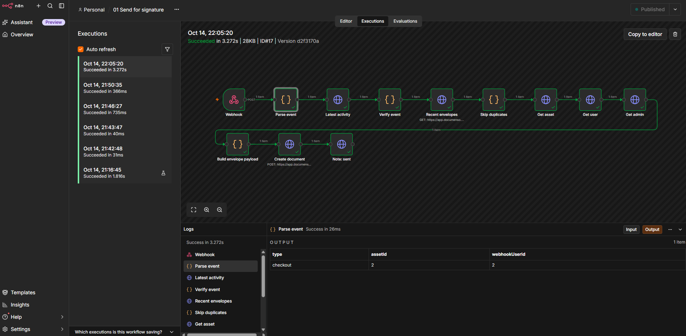

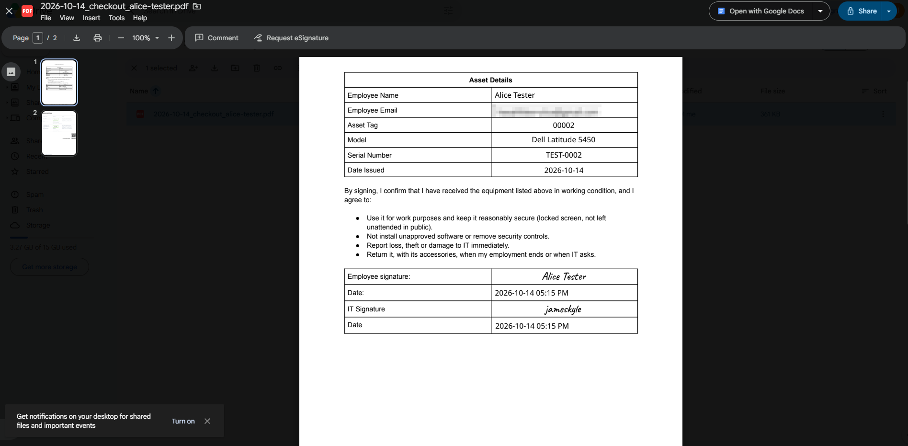

**Recommendation for the Terraform phase: codify the self-hosted version.** It removes the internet-facing API entirely, costs nothing extra on the existing server, puts every component under one definition, and leaves only the Google OAuth app as a manual step. The mTLS design stays in this write-up as the answer for when a company has to use a SaaS automation tool: it's the right pattern for that constraint, just not the cheapest one when self-hosting is allowed.

## Known limitations

- **Timezones (fixed in the self-hosted version).** n8n Cloud ran on UTC and Documenso stamped signing times in each signer's browser timezone, so a return processed early in the morning got the previous day's date. The rebuild sets Asia/Qatar explicitly everywhere. Records created before the switch still display the old clock time, because Snipe-IT stores times without a timezone.
- **A checkout made while n8n is down gets no agreement.** Snipe-IT sends its webhook once, in the background, with no retry and no alert; I confirmed the failure by stopping n8n. A company would add a daily reconciliation (Snipe-IT checkouts against Documenso's documents) and uptime monitoring on n8n.
- **The Google OAuth app is unverified.** That's fine for a single-user app, but signing in shows Google's "unverified app" warning, and a multi-user setup would need Google's verification.
- **Snipe-IT's webhook can't be authenticated.** The workflow compensates by verifying every event through the API.
- **The event type is read from the webhook's human-readable text** ("Asset checked out"), which changes with Snipe-IT's language setting. The API check catches a misread, but the parsing is still brittle.
- **Volume.** Documenso's free plan allows 5 documents a month, so real use needs a paid plan or self-hosted Documenso. A bulk onboarding day (dozens of laptops at once) would also need batching and a calmer reminder email.
- **Free-plan emails come from a shared domain.** Gmail marks Documenso's free-plan emails as suspicious. A company would send from its own domain (SPF/DKIM) so employees don't learn to ignore warnings on signing emails.
- **n8n keeps run data, including webhook headers** (and so the Documenso secret). The self-hosted version deletes run history after 14 days. In production I'd also stop saving successful runs of the two workflows that handle secrets.
- **Snipe-IT runs a pre-release build** (`latest` turned out to track the development branch). The Terraform version will pin a stable release.

## What's next

1. ~~Align all systems to one business timezone.~~ Done in the self-hosted rebuild.
2. ~~Rebuild with self-hosted n8n and compare the two deployments.~~ Done, see above.
3. Test Snipe-IT's built-in acceptance and confirm the comparison above.
4. Tear down the hand-built infrastructure and rebuild the **self-hosted version** with **Terraform**: pinned Snipe-IT and n8n versions, user-data for Docker, swap and the config files, and automated EBS snapshots.
5. Add a daily reconciliation so a checkout made during an n8n outage can't go unnoticed.
6. Final architecture diagram and a short demo recording.

The full build log, including commands and every dead end, is in [`docs/notes.md`](notes.md).
